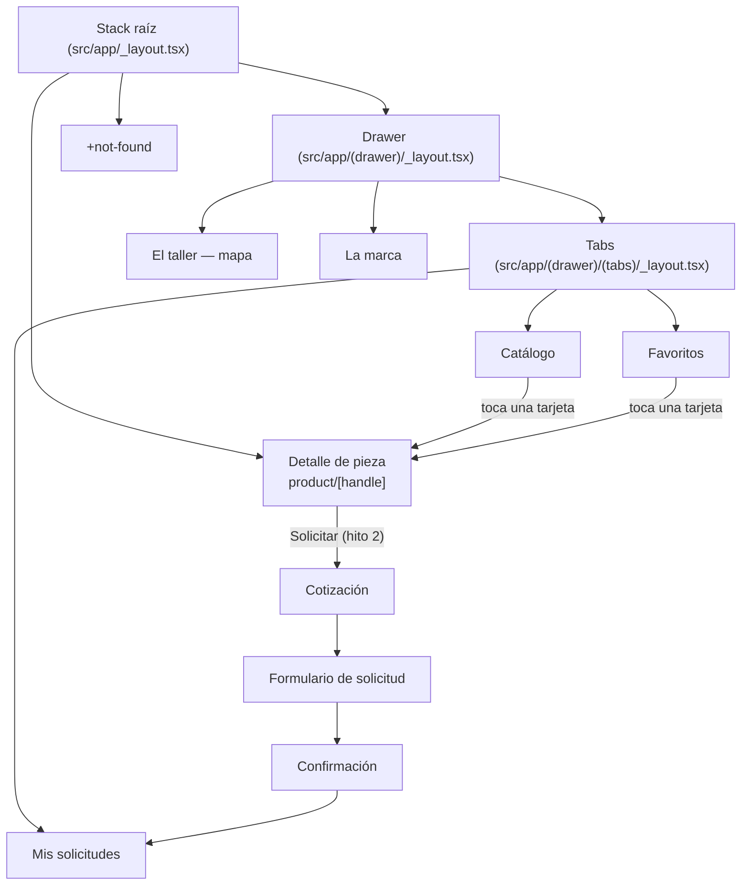

# Mapa de pantallas

| Navegador | Función real | Pantallas |
| --- | --- | --- |
| **Stack** | Flujo del pedido y retroceso | Detalle → Cotización → Formulario → Confirmación |
| **Tabs** | Secciones frecuentes | Catálogo, Favoritos, Mis solicitudes |
| **Drawer** | Accesos complementarios | Inicio, El taller (mapa), La marca |

**Estado al cierre del hito 1:** Stack, Tabs, Drawer, la ruta dinámica `product/[handle]` (incluido el identificador
inexistente) y la pantalla 404 ya funcionan. Cotización, formulario y confirmación se agregan en el hito 2.
