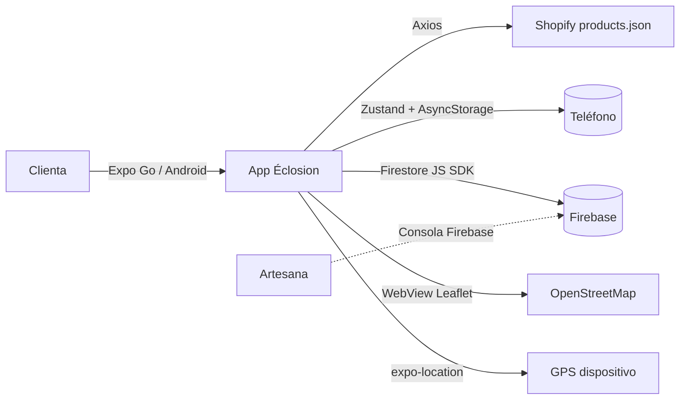
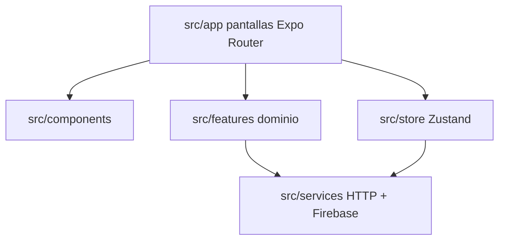
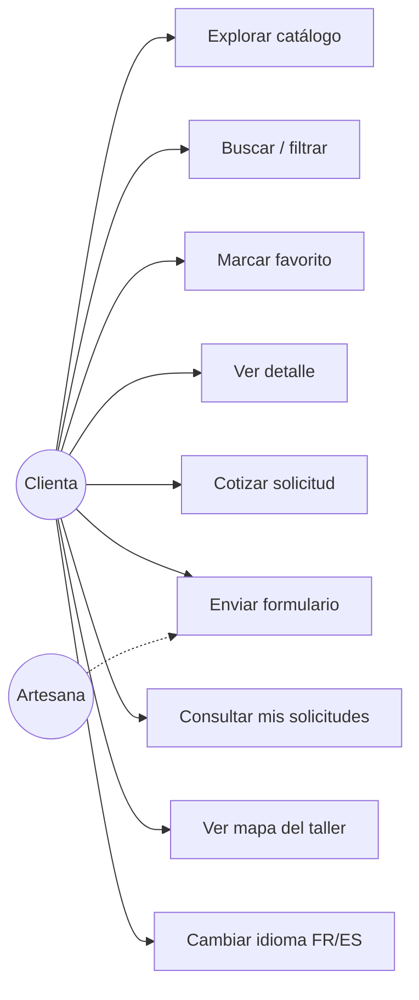
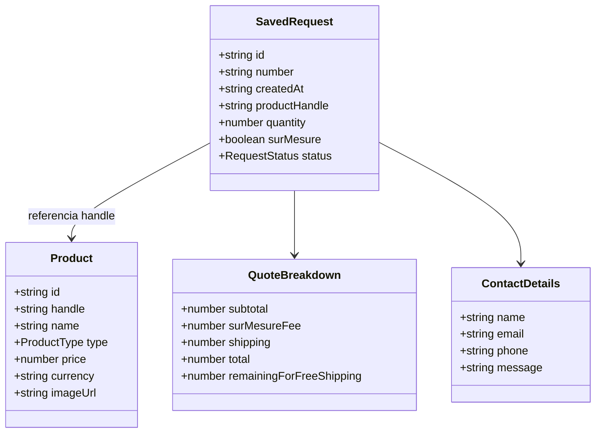
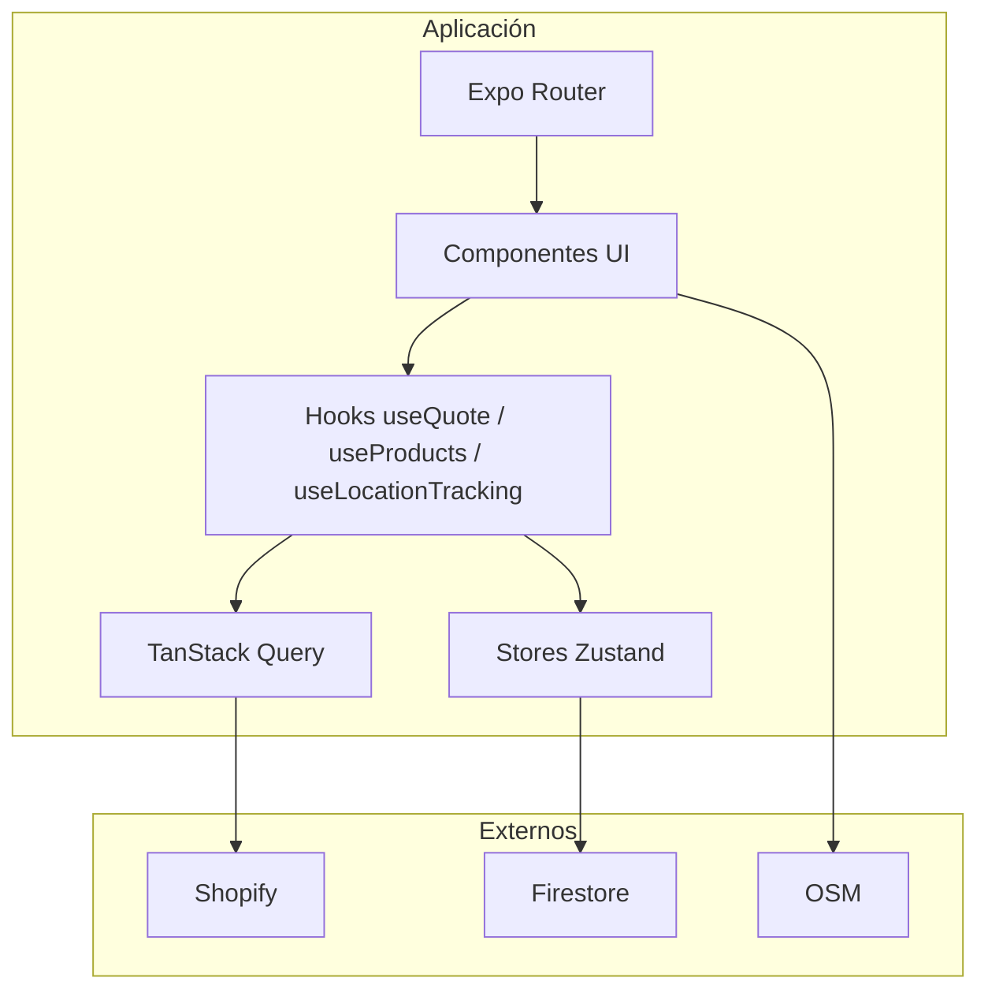
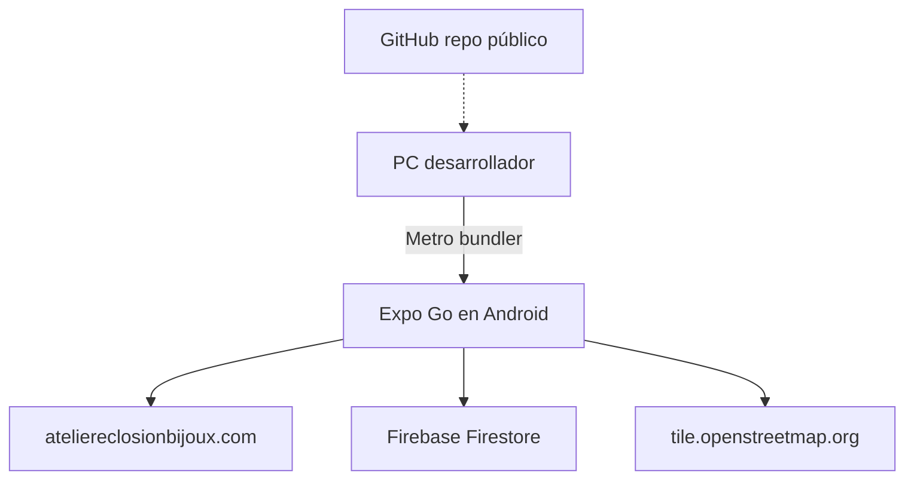
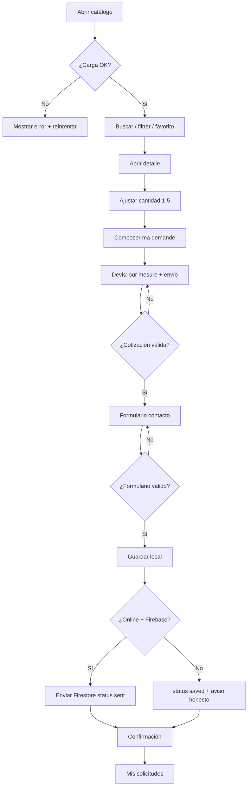
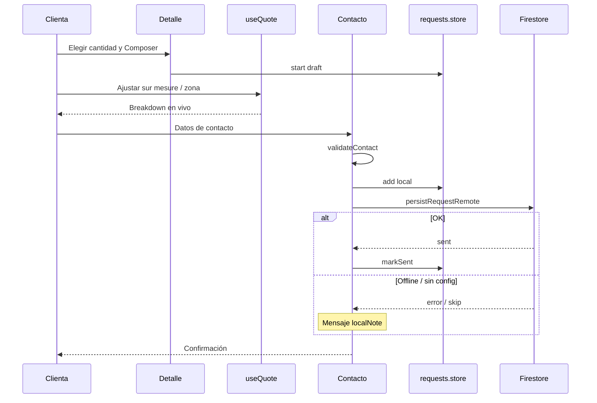
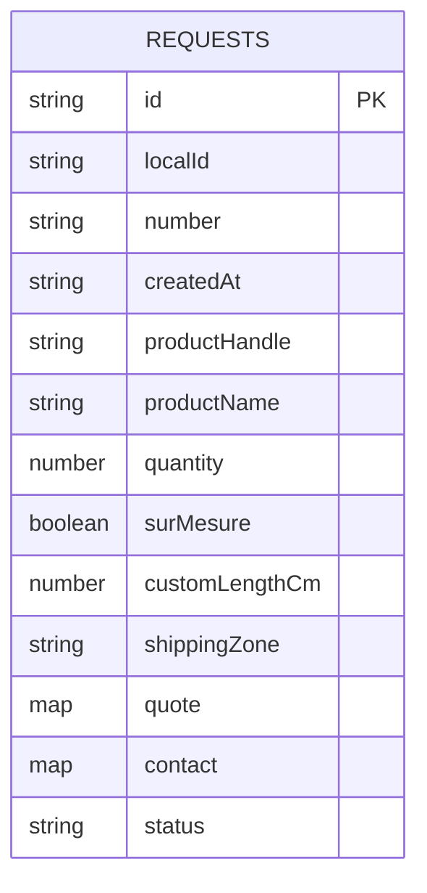

# Informe final — Éclosion Bijoux

**Asignatura:** Desarrollo Móvil II (UAM)  
**Autor:** Juan José Arango Jaramillo  
**Cliente:** Atelier Éclosion Bijoux (Mulhouse, Francia)  
**Stack:** React Native · TypeScript · Expo SDK 57  
**Repositorio:** https://github.com/Arango134204/atelier-eclosion-app

---

## 1. Generalidades

### 1.1 Propósito del sistema

Aplicación móvil que permite a las clientas explorar el catálogo artesanal real de Atelier Éclosion Bijoux, cotizar piezas (incluidas personalizaciones *sur mesure*) y registrar solicitudes en el dispositivo para consultarlas después.

### 1.2 Definición del problema

Hoy los encargos se negocian por Instagram/WhatsApp: mensajes dispersos, precios poco claros hasta que la artesana responde, y sin registro único de solicitudes ni forma sencilla de ubicar el taller.

### 1.3 Solución

App Expo con:

1. Catálogo HTTP desde la API pública Shopify del cliente.
2. Cotización con reglas explícitas (cantidad, sur mesure, envío).
3. Formulario validado y persistencia local (AsyncStorage): las solicitudes se conservan al cerrar y reabrir la app.
4. Mapa del taller (OpenStreetMap + Leaflet) con ubicación del dispositivo.

### 1.4 Stakeholders

| Actor | Rol | Prioridad |
| --- | --- | --- |
| Clienta | Explora, cotiza y solicita piezas | Alta |
| Artesana | Dueña del negocio; fuera de la app en esta entrega (sin sincronización entre dispositivos) | Media |
| Equipo académico | Evalúa cobertura de temas del curso | Media |

### 1.5 Justificación

Digitaliza el proceso de solicitud sin sustituir el oficio artesanal: da transparencia de precio estimado y centraliza pedidos, manteniendo francés como idioma de marca y español para el equipo/evaluación.

---

## 2. Requerimientos

### 2.1 Funcionales (resumen)

| ID | Requisito | Estado |
| --- | --- | --- |
| RF01 | Catálogo remoto (listado + detalle) | Cumplido |
| RF02 | Búsqueda y filtro por tipo | Cumplido |
| RF03 | Favoritos persistentes | Cumplido |
| RF04 | Contador 1–5 y total en vivo | Cumplido |
| RF05 | Cotización sur mesure + envío | Cumplido |
| RF06 | Formulario de contacto validado | Cumplido |
| RF07 | Persistencia de solicitudes | Cumplido (AsyncStorage en el teléfono) |
| RF08 | Mapa del taller + GPS | Cumplido |
| RF09 | i18n FR/ES | Cumplido |

### 2.2 No funcionales

- Tipado estricto TypeScript; sin `any` como solución general.
- UI con NativeWind, tipografías Cormorant Garamond + Jost, paleta de marca.
- Sin confirmaciones falsas de envío.
- Variables sensibles solo vía `.env` (plantilla en `.env.template`).

La matriz completa está en `docs/03-matriz-requisitos.md`.

---

## 3. Arquitectura

### 3.1 Visión global



### 3.2 Capas



---

## 4. Diseño detallado — diagramas UML

### 4.1 Casos de uso



### 4.2 Diagrama de clases (dominio)



### 4.3 Diagrama de componentes



### 4.4 Diagrama de despliegue



### 4.5 Diagrama de actividades — proceso principal



### 4.6 Diagrama de secuencia — cotizar y enviar



### 4.7 Modelo de datos Firestore



---

## 5. Mapa de pantallas

Ver `docs/02-mapa-pantallas.md`. Navegación: **Drawer** (Inicio, Taller, Marca) + **Tabs** (Creaciones, Favoritos, Solicitudes) + **Stack** (Detalle → Devis → Coordenadas → Confirmación).

---

## 6. Organización del código

```
src/app/                 Rutas Expo Router
src/components/          UI reutilizable
src/features/catalog/    API Shopify, mapper, hooks Query
src/features/quote/      Reglas y cálculo
src/features/request/    Validación de contacto
src/features/atelier/    Mapa + GPS
src/store/               Zustand (idioma, favoritos, draft, requests)
src/services/            HTTP Axios + Firebase
docs/                    Alcance, matriz, bitácora, informe, evidencias
```

---

## 7. Reglas de negocio

Centralizadas en `src/features/quote/quote.rules.ts` (provisionales, pendientes de confirmación con la clienta):

- Cantidad 1–5
- Sur mesure +15 %
- Envío FR 5 € / UE 9 € / INT 15 €; gratis desde 120 €
- Largo aretes 3–12 cm; pulseras 14–22 cm

---

## 8. Pruebas y evidencias

- Hito 1–2: `docs/evidencias/2026-11-03-*` y `2026-11-09-hito2-*`
- Flujo verificado en emulador Android (Expo Go SDK 57)
- Persistencia local tras `force-stop`
- Typecheck: `npm run typecheck`

### Prueba con usuario representativo

| Campo | Registro |
| --- | --- |
| Fecha | 2026-11-19 |
| Usuario | Representativo (equipo) — Juan José Arango Jaramillo |
| Tarea | Solicitar Peonia × 2 sur mesure 7,5 cm envío UE |
| Resultado | Cotización 112,50 €; solicitud ÉC-0001 guardada |
| Dificultad | Coordenadas exactas del taller pendientes de la clienta |
| Ajuste | Mensajes honestos sent/saved; mapa con leyenda atelier/tú |

---

## 9. Límites conocidos

1. Coordenadas del taller = centro de Mulhouse hasta confirmar dirección.
2. Las solicitudes no se sincronizan entre dispositivos (persistencia local deliberada; el enunciado no exige nube si no se promete intercambio).
3. Catálogo depende de la API pública Shopify (puede rate-limitar).
4. No hay pagos ni autenticación (fuera de alcance).
5. Firestore queda documentado como mejora opcional, no como requisito de entrega.

---

## 10. Conclusión

El proceso principal queda cerrado de punta a punta con los temas obligatorios del curso (navegación, estado, HTTP, mapa, persistencia local y documentación).
